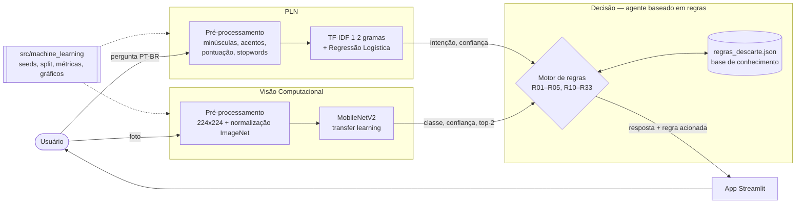
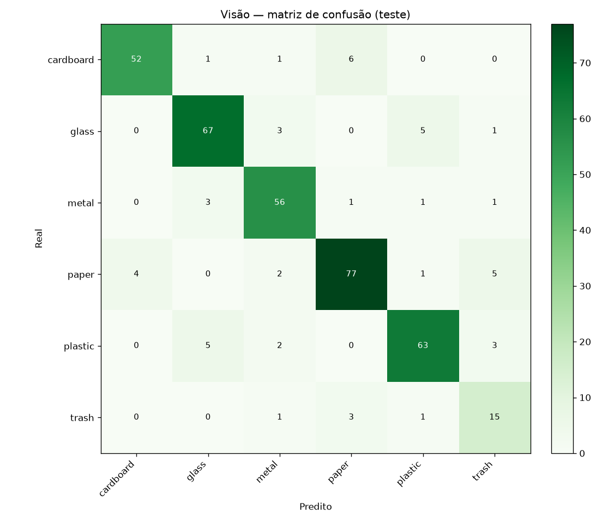
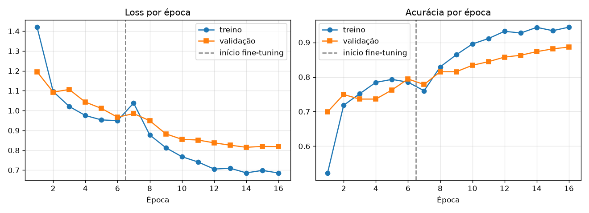
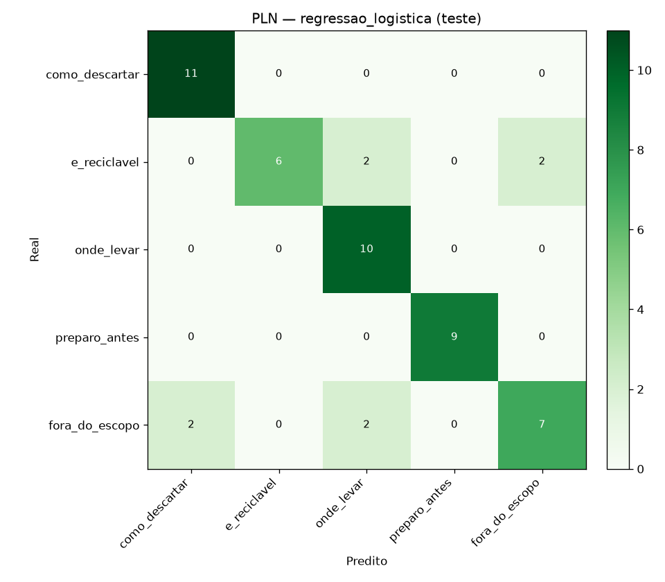

# ♻️ EcoSort — Classificação de Resíduos com Visão Computacional e PLN

Projeto final da disciplina de **Inteligência Artificial — AFYA/UNIMA**.

## Integrantes
- `<Nome do integrante 1>` — `<matrícula>`
- `<Nome do integrante 2>` — `<matrícula>`
- `<Nome do integrante 3>` — `<matrícula>`
- `<Nome do integrante 4>` — `<matrícula>`

**Artigo (Overleaf):** `<COLE_AQUI_O_LINK_DO_OVERLEAF>` — veja também [`artigo/`](artigo/).

---

## 1. Problema
O descarte incorreto de resíduos contamina a coleta seletiva e reduz a reciclagem. Muitas pessoas não sabem
**em qual lixeira** colocar um objeto, **se ele é reciclável**, **como prepará-lo** ou **onde entregá-lo**.
O EcoSort recebe uma **foto** do resíduo e uma **pergunta em português** e responde de forma contextualizada,
seguindo o padrão de cores da coleta seletiva brasileira (Resolução CONAMA 275/2001).

## 2. Fluxo funcional
1. O usuário envia uma foto do resíduo.
2. **Visão Computacional** classifica o material (`cardboard`, `glass`, `metal`, `paper`, `plastic`, `trash`) e retorna confiança e top-2.
3. O usuário digita uma pergunta (ex.: *"como descarto isso?"*, *"isso é reciclável?"*, *"onde posso levar?"*, *"precisa lavar antes?"*).
4. **PLN** reconhece a intenção (`como_descartar`, `e_reciclavel`, `onde_levar`, `preparo_antes`, `fora_do_escopo`).
5. **Decisão** (sistema baseado em regras) combina classe + confiança + intenção e gera a resposta; com confiança < 0,6 mostra as 2 classes mais prováveis ou pede outra foto.
6. A interface **Streamlit** mostra imagem, classe, confiança, intenção, regra acionada e resposta.

## 3. Arquitetura



### Papel real do componente de decisão (requisito obrigatório)
Visão e PLN apenas **percebem**: um estima *o que é o objeto*, o outro *o que o usuário quer saber* — cada um com
uma incerteza. Nenhum deles sabe **o que responder**. O módulo `src/decisao/motor_regras.py` é um **agente reativo
baseado em regras** que:

1. **Raciocina sobre a incerteza** das duas percepções antes de agir:
   - confiança da visão < 0,35 → **R02**: não arrisca, pede outra foto;
   - 0,35 ≤ confiança < 0,6 → se as 2 classes mais prováveis vão para a **mesma lixeira** (papel × papelão), **R03** responde com segurança; senão **R04** mostra as duas hipóteses e pede nova foto;
   - confiança do PLN < 0,4 → **R05**: dá um resumo geral do material em vez de adivinhar a intenção.
2. **Consulta a base de conhecimento** `dados/regras_descarte.json` (reciclável?, cor da lixeira, preparo, destino) e aplica uma das **24 regras explícitas** `SE classe=X E intenção=Y E confiança ≥ 0,6 ENTÃO resposta Z` (R10–R33, uma por combinação classe × intenção).
3. **Trata perguntas fora do escopo** (**R01**).
4. **Torna a decisão explicável**: cada resposta traz o ID e a descrição da regra que disparou (exibidos no app).

Impacto medido: com o limiar 0,6 o sistema responde direto em 76,3% das imagens de teste com 96,6% de acerto
(contra 86,8% de acerto se respondesse sempre) — ver [`resultados/analise_erros.md`](resultados/analise_erros.md).
Sem esse componente o sistema seria apenas dois classificadores desconectados.

## 4. Tecnologias
Python 3.10+ (testado em 3.12) · PyTorch + torchvision (MobileNetV2) · scikit-learn (TF-IDF, Regressão Logística,
Naive Bayes) · pandas/numpy · matplotlib · Streamlit · pytest. Tudo roda em **CPU** (ou Google Colab gratuito), sem APIs pagas.

## 5. Estrutura do repositório
```
ecosort/
├── app.py                      # Interface Streamlit
├── requirements.txt  pytest.ini  .gitignore
├── README.md  DECISOES.md  RELATORIO_FINAL.md
├── src/
│   ├── pipeline.py             # Fluxo integrado Visão -> PLN -> Decisão
│   ├── visao_computacional/    # preparar_dados.py, modelo.py, treinar.py, predict.py
│   ├── pln/                    # preprocessamento.py, treinar.py, interpretar.py
│   ├── decisao/                # motor_regras.py
│   └── machine_learning/       # utils.py (seeds, split, métricas, gráficos)
├── scripts/                    # gerar_exemplos.py, analise_erros.py, criar_notebooks.py
├── notebooks/                  # 01_treino_modelos.ipynb, 02_analise_resultados.ipynb
├── dados/                      # intencoes.csv, regras_descarte.json, split_imagens.csv, exemplos/ (bruto/ não versionado)
├── modelos/                    # visao_mobilenetv2.pt (9 MB), pln_intencoes.pkl (50 KB)
├── resultados/                 # métricas JSON, graficos/, exemplos/, analise_erros.md
├── testes/                     # test_ecosort.py
└── artigo/
```

## 6. Instalação (passo a passo)

> Pré-requisito: Python 3.10 ou superior. No Windows, se a pasta do projeto tiver um caminho muito longo, crie o
> ambiente virtual num caminho curto (ex.: `C:\venvs\ecosort`) — veja `DECISOES.md` item 2.

```bash
# 1) Entrar na pasta do projeto
cd ecosort

# 2) Criar e ativar o ambiente virtual
python -m venv .venv
# Windows (PowerShell):  .venv\Scripts\Activate.ps1
# Linux/macOS:           source .venv/bin/activate

# 3) Instalar o PyTorch só-CPU (mais leve) e as demais dependências
pip install torch torchvision --index-url https://download.pytorch.org/whl/cpu
pip install -r requirements.txt
```

**Google Colab:** `!git clone <url> && %cd ecosort && !pip install -r requirements.txt` e depois os mesmos comandos abaixo com `!`.

## 7. Execução

Todos os comandos são executados **na raiz do projeto** (`ecosort/`).

| Passo | Comando | Tempo aprox. (CPU 8 threads) |
|---|---|---|
| 1. Baixar e dividir o TrashNet (42 MB) | `python -m src.visao_computacional.preparar_dados` | 1 min |
| 2. Treinar a visão | `python -m src.visao_computacional.treinar` | ~8–10 min |
| 3. Treinar/comparar o PLN | `python -m src.pln.treinar` | ~10 s |
| 4. Rodar os testes | `python -m pytest -v` | ~10 s |
| 5. Gerar exemplos do fluxo | `python -m scripts.gerar_exemplos` | ~10 s |
| 6. Gerar análise de erros | `python -m scripts.analise_erros` | ~10 s |
| 7. Abrir o app | `streamlit run app.py` → http://localhost:8501 | — |

> Os modelos treinados já estão em `modelos/`; para **só usar o app** basta instalar e rodar os passos 4 e 7.
> O passo 1 é necessário apenas para retreinar a visão ou regenerar exemplos/análises (que usam o conjunto de teste).

Uso programático:
```python
from src.pipeline import processar
r = processar("dados/exemplos/glass183.jpg", "precisa lavar antes?")
print(r["visao"], r["pln"], r["decisao"]["regra_id"], r["decisao"]["resposta"], sep="\n")
```

## 8. Modelos e dados
| Módulo | Dados | Modelo |
|---|---|---|
| Visão | TrashNet (2.527 imagens, 6 classes) — split estratificado 70/15/15 (1.768 / 379 / 380), seed 42 | MobileNetV2 (ImageNet). Fase 1: base congelada, 6 épocas, lr 1e-3. Fase 2: fine-tuning dos 5 últimos blocos, 10 épocas, lr 1e-4, cosine. CE com pesos por classe + label smoothing 0,1. Augmentation só no treino. |
| PLN | `dados/intencoes.csv`: 335 frases PT-BR próprias (5 intenções, com gírias e erros de digitação) — split 70/15/15 (234 / 50 / 51) | TF-IDF (uni+bigramas) + Regressão Logística (C=3); baseline Multinomial Naive Bayes (α=0,5). Hiperparâmetros escolhidos na validação. |
| Decisão | `dados/regras_descarte.json` (6 materiais, cores CONAMA) | 29 regras SE-ENTÃO com prioridade (R01–R05 + R10–R33) |

## 9. Resultados (execução real, conjunto de teste)

### Visão — MobileNetV2 (380 imagens)
**Acurácia: 0,8684 · F1 macro: 0,8461** · melhor acurácia de validação: 0,8865

| Classe | Precision | Recall | F1 | n |
|---|---:|---:|---:|---:|
| cardboard | 0,929 | 0,867 | 0,897 | 60 |
| glass | 0,882 | 0,882 | 0,882 | 76 |
| metal | 0,862 | 0,903 | 0,882 | 62 |
| paper | 0,885 | 0,865 | 0,875 | 89 |
| plastic | 0,887 | 0,863 | 0,875 | 73 |
| trash | 0,600 | 0,750 | 0,667 | 20 |

| Matriz de confusão | Curvas de treino |
|---|---|
|  |  |

Acurácia em nível de **lixeira** (papel e papelão contam como acerto entre si): **0,8947**.
Com o limiar de 0,6: cobertura 76,3%, acurácia das respostas diretas 96,6%.

### PLN — comparação (51 frases de teste + validação cruzada 5-fold em 335 frases)
| Modelo | Acurácia teste | F1 macro teste | CV5 acurácia | CV5 F1 macro |
|---|---:|---:|---:|---:|
| **TF-IDF + Regressão Logística** (C=3) | **0,8431** | **0,8400** | 0,8328 ± 0,0466 | 0,8301 ± 0,0486 |
| TF-IDF + Naive Bayes (α=0,5) | 0,7451 | 0,7365 | 0,7522 ± 0,0307 | 0,7320 ± 0,0378 |



### Fluxo integrado e testes
- **37 testes pytest passando** (visão, PLN, cobertura das 24 combinações classe × intenção, limiares, fluxo ponta a ponta).
- **14 exemplos** de entrada/saída (acertos, erros, baixa confiança, fora do escopo, gírias, erros de digitação) em
  [`resultados/exemplos/exemplos.md`](resultados/exemplos/exemplos.md) e no painel `resultados/exemplos/painel_exemplos.png`.
- Análise de erros: [`resultados/analise_erros.md`](resultados/analise_erros.md).

## 10. Limitações
- **Viés do TrashNet**: fotos com fundo branco, um objeto, boa iluminação. Fotos reais (fundo poluído, vários objetos) tendem a ter menor confiança e acurácia.
- **Classe `trash` fraca** (F1 0,667): pouca amostra (137 imagens) e definição semântica ("o que não é reciclável").
- **Vidro × plástico transparentes** são a confusão mais perigosa; erros confiantes (ex.: vidro → plástico com 0,83) passam pelo limiar.
- **6 classes apenas**: não há orgânico, eletrônicos, pilhas, isopor, embalagem longa-vida etc.
- **PLN baseado em palavras**: sensível a erros de digitação fora do vocabulário e a frases fora do escopo que compartilham palavras do domínio ("onde fica o hospital?"). Dataset pequeno (335 frases).
- **Destinos genéricos**: o sistema não sabe a localização do usuário; indica tipos de locais (ecopontos, cooperativas), não endereços.
- Confiança = probabilidade softmax, que não é calibrada formalmente.

## 11. Referências
- YANG, M.; THUNG, G. *Classification of Trash for Recyclability Status*. CS229 Project Report, Stanford, 2016. Dataset: https://github.com/garythung/trashnet
- SANDLER, M. et al. *MobileNetV2: Inverted Residuals and Linear Bottlenecks*. CVPR, 2018.
- DENG, J. et al. *ImageNet: A large-scale hierarchical image database*. CVPR, 2009.
- PEDREGOSA, F. et al. *Scikit-learn: Machine Learning in Python*. JMLR, 12, 2011.
- PASZKE, A. et al. *PyTorch: An Imperative Style, High-Performance Deep Learning Library*. NeurIPS, 2019.
- CONAMA. *Resolução nº 275, de 25 de abril de 2001* — código de cores para a coleta seletiva.
- BRASIL. *Lei nº 12.305/2010* — Política Nacional de Resíduos Sólidos.
- RUSSELL, S.; NORVIG, P. *Inteligência Artificial: uma abordagem moderna*. 4ª ed. (agentes reativos e sistemas baseados em regras).
