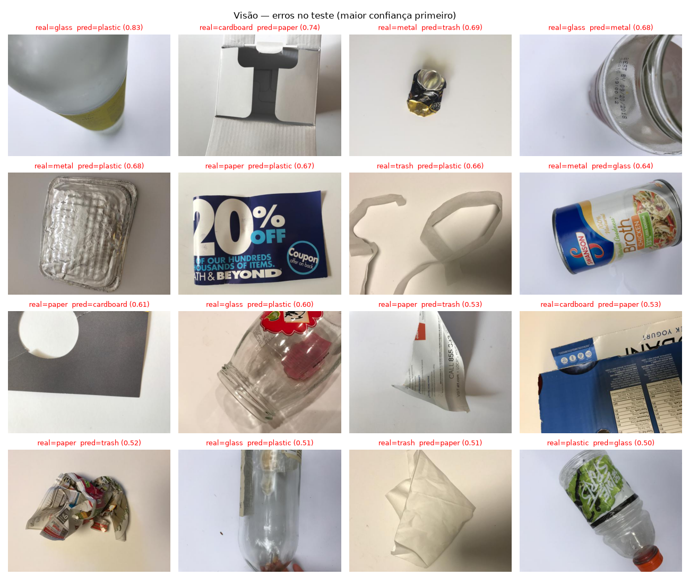

# Análise de erros — EcoSort

Todos os números abaixo vêm das execuções reais (`resultados/predicoes_teste_visao.csv`,
`resultados/metricas_pln.json`). Tabelas completas em [`analise_erros_dados.md`](analise_erros_dados.md)
(gerado por `python -m scripts.analise_erros`).

## 1. Visão computacional (380 imagens de teste, 50 erros, acurácia 0,8684)

### Pares mais confundidos

| Real → Predito | Erros | Por quê |
|---|---:|---|
| cardboard → paper | 6 | Papelão fino, cartolina e caixas brancas/impressas têm textura e cor muito parecidas com papel; em close-up, a ondulação do papelão (principal pista) não aparece. |
| paper → cardboard | 4 | Simétrico ao anterior: papel cinza/grosso (ex.: cartolina) parece papelão. |
| glass ↔ plastic | 5 + 5 | Garrafas e potes transparentes: o que distingue vidro de plástico (espessura, brilho, deformação) é sutil numa foto 224×224 com fundo branco. Rótulos coloridos de bebidas aparecem nas duas classes. |
| paper → trash | 5 | A classe `trash` do TrashNet contém muitos papéis sujos/plastificados, embalagens metalizadas e lenços — papel amassado ou impresso se parece com esses itens. |
| plastic → trash, trash → paper | 3 + 3 | `trash` é a classe mais heterogênea (não é um material, e sim "o resto") e a menor (137 imagens; 20 no teste). |
| glass ↔ metal | 3 + 3 | Reflexos especulares: latas brilhantes e vidros com reflexo metálico; lata de sopa com rótulo inteiro (sem metal visível) foi chamada de vidro. |

### Por classe
- **trash** é a pior (recall 0,75; precisão 0,60; F1 0,667): pouca amostra, classe definida por exclusão e visualmente diversa. Os pesos por classe aumentaram o recall às custas da precisão (5 papéis previstos como `trash`).
- **metal** é a melhor (recall 0,903): brilho e formato de lata são pistas fortes.

### Gravidade real dos erros (o que importa para o usuário)
- Dos 50 erros, **10 (20%) são papel ↔ papelão**, que vão para a mesma lixeira AZUL — ou seja, não alteram a orientação. A "acurácia de lixeira" no teste é **0,8947** (40 erros mudam a lixeira).
- A confiança separa bem acertos de erros: média **0,78** nos acertos e **0,47** nos erros (`graficos/visao_confianca_hist.png`).
- Com o limiar 0,6, o sistema responde direto em **76,3%** das imagens com **96,6%** de acerto; só **10** erros passam do limiar e, desses, **8** mudam a lixeira (ex.: vidro→plástico com 0,83 — o erro mais confiante). As outras 23,7% recebem top-2 (R03/R04) ou pedido de nova foto (R02).
- Trade-off (`graficos/limiar_cobertura.png`): limiar 0,5 → cobertura 84,5% / acurácia 95,0%; limiar 0,7 → 64,2% / 99,2%. 0,6 foi mantido como equilíbrio.

### Causas estruturais
1. **Viés do dataset**: o TrashNet tem fundo branco, um objeto por foto e iluminação controlada. Fotos reais (fundo poluído, vários objetos, mão segurando) tendem a ter confiança menor — por isso o tratamento de baixa confiança no módulo de decisão é essencial.
2. **Rótulo "trash" é semântico, não visual** — misturar o que é rejeito com o que é material reciclável sujo é ambíguo até para humanos.
3. **Resolução 224×224** apaga detalhes finos (espessura do vidro, ondulação do papelão).
4. **Leve overfitting** no fim do treino (acurácia de treino 0,944 × validação 0,887), mas a validação ainda subia — mais épocas/dados ajudariam.

## 2. PLN (51 frases de teste)

| Modelo | Acurácia teste | F1 macro teste | CV 5-fold acurácia |
|---|---:|---:|---:|
| TF-IDF + Regressão Logística (C=3) | 0,8431 | 0,8400 | 0,8328 ± 0,0466 |
| TF-IDF + Naive Bayes (α=0,5) | 0,7451 | 0,7365 | 0,7522 ± 0,0307 |

### Erros da Regressão Logística (8)

| Frase | Real | Predito | Por quê |
|---|---|---|---|
| quem ganhou o **jogo** ontem? | fora | como_descartar | "jogo" (do verbo jogar) aparece em muitas frases de descarte ("jogo isso fora"); o TF-IDF não distingue o substantivo do verbo. |
| vai chover amanhã? | fora | como_descartar | "vai" aparece em "vai em qual lixo?"; nenhuma outra palavra é conhecida. |
| **onde fica** a praia / o hospital | fora | onde_levar | "onde fica" é um bigrama forte de `onde_levar` ("onde fica o ecoponto"). O modelo aprendeu a estrutura da pergunta, não o objeto. |
| entra na / aceito na **coleta seletiva**? | e_reciclavel | onde_levar | "coleta" é muito associada a lugares ("ponto de coleta"). Ambiguidade legítima. |
| isso e **recilavel**? | e_reciclavel | fora | Erro de digitação gera token desconhecido; com n-gramas de palavras não há como aproveitar a semelhança com "reciclavel". |
| isso é **rejeito**? | e_reciclavel | fora | "rejeito" aparece poucas vezes no treino. |

**Padrões:** (1) 4 de 8 erros envolvem `fora_do_escopo` — frases fora do domínio que compartilham palavras com o domínio; (2) erros de digitação fora do vocabulário. O Naive Bayes erra mais (13) porque supõe independência entre termos e é mais sensível a palavras frequentes (ex.: "kkkkkk" → como_descartar).

**Mitigações já implementadas:** confiança do PLN abaixo de 0,4 aciona a regra R05 (resumo geral), e `fora_do_escopo` incerto não bloqueia a resposta.
**Melhorias futuras:** n-gramas de caracteres (robustez a erros de digitação), mais exemplos negativos com "onde fica"/"jogo", embeddings de sentenças (ex.: BERTimbau).

## 3. Fluxo integrado

Nos 14 exemplos de `resultados/exemplos/`, os casos de erro mostram o papel do componente de decisão:
- **Caso 07** (vidro → plástico, conf. 0,83): erro confiante — passa do limiar e a resposta sai errada (lixeira vermelha). É a principal limitação: o limiar não protege contra erros confiantes.
- **Caso 08** (papelão → papel, 0,74): erro "benigno" — mesma lixeira azul, resposta correta.
- **Caso 09** (vidro, conf. 0,598 < 0,6): R04 mostra as duas hipóteses (vidro 0,60 × papelão 0,13) e pede nova foto, em vez de arriscar — aqui a top-1 estava certa, então o limiar foi conservador.
- **Caso 10** (papel previsto como papelão, conf. 0,36): R03 percebe que as 2 hipóteses vão para a lixeira azul e responde corretamente mesmo com baixa confiança.
- **Caso 11** (conf. 0,29): R02 pede nova foto.
- **Caso 14** (pergunta vaga, PLN 0,33): R05 dá um resumo em vez de chutar a intenção.
