# Exemplos de entrada/saída do fluxo completo

Gerado automaticamente por `python -m scripts.gerar_exemplos` com imagens do conjunto de TESTE.

### Caso 01 — Acerto, alta confiança — como descartar

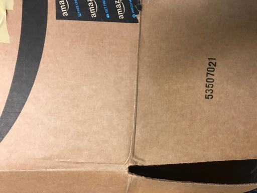

| Campo | Valor |
|---|---|
| Classe real | `cardboard` |
| Pergunta | "como descarto isso?" |
| Visão | `cardboard` (conf. 0.994) — top-2: cardboard 0.99, trash 0.00 |
| PLN | `como_descartar` (conf. 0.893) |
| Regra acionada | **R10** — SE classe=cardboard E intenção=como_descartar E confiança>=0.60 ENTÃO resposta 'como_descartar' para 'cardboard' |
| Visão acertou? | sim |

**Resposta:**

> Isso parece ser **papelão**. Descarte na lixeira AZUL (papel) da coleta seletiva, junto com outros papéis secos.

### Caso 02 — Acerto, alta confiança — preparo

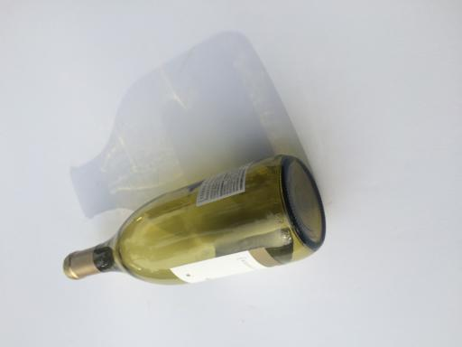

| Campo | Valor |
|---|---|
| Classe real | `glass` |
| Pergunta | "precisa lavar antes?" |
| Visão | `glass` (conf. 0.990) — top-2: glass 0.99, cardboard 0.00 |
| PLN | `preparo_antes` (conf. 0.948) |
| Regra acionada | **R17** — SE classe=glass E intenção=preparo_antes E confiança>=0.60 ENTÃO resposta 'preparo_antes' para 'glass' |
| Visão acertou? | sim |

**Resposta:**

> Antes de descartar **vidro**:
> - Enxágue para retirar restos de bebida/alimento (não precisa ficar perfeito).
> - Retire tampas metálicas ou plásticas e descarte-as em suas lixeiras (amarela/vermelha).
> - Vidro quebrado: embrulhe em jornal ou coloque numa caixa e identifique 'VIDRO QUEBRADO' para proteger os coletores.

### Caso 03 — Acerto, alta confiança — onde levar

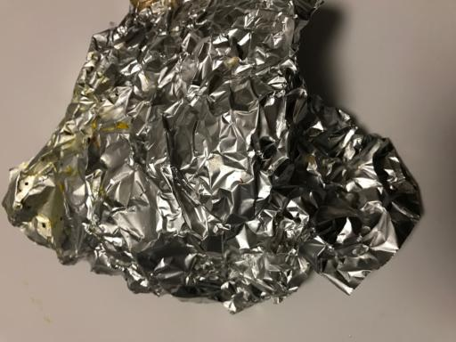

| Campo | Valor |
|---|---|
| Classe real | `metal` |
| Pergunta | "onde posso levar?" |
| Visão | `metal` (conf. 0.984) — top-2: metal 0.98, trash 0.01 |
| PLN | `onde_levar` (conf. 0.905) |
| Regra acionada | **R20** — SE classe=metal E intenção=onde_levar E confiança>=0.60 ENTÃO resposta 'onde_levar' para 'metal' |
| Visão acertou? | sim |

**Resposta:**

> Para **metal**: Coleta seletiva, ecopontos, cooperativas e ferros-velhos/sucateiros (latinhas de alumínio têm alto valor de revenda).

### Caso 04 — Acerto, alta confiança — é reciclável

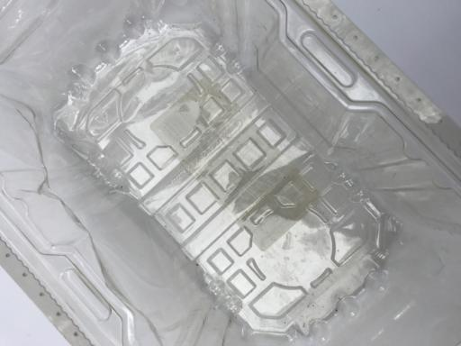

| Campo | Valor |
|---|---|
| Classe real | `plastic` |
| Pergunta | "isso é reciclável?" |
| Visão | `plastic` (conf. 0.992) — top-2: plastic 0.99, paper 0.00 |
| PLN | `e_reciclavel` (conf. 0.973) |
| Regra acionada | **R27** — SE classe=plastic E intenção=e_reciclavel E confiança>=0.60 ENTÃO resposta 'e_reciclavel' para 'plastic' |
| Visão acertou? | sim |

**Resposta:**

> Sim! **Plástico** é reciclável. Coloque na lixeira **VERMELHA**. Verifique o símbolo de reciclagem (1 a 7) na embalagem para identificar o tipo de plástico.

### Caso 05 — Acerto, classe rejeito (não reciclável)

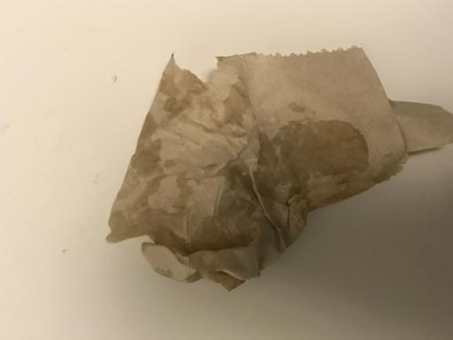

| Campo | Valor |
|---|---|
| Classe real | `trash` |
| Pergunta | "da pra reciclar isso?" |
| Visão | `trash` (conf. 0.998) — top-2: trash 1.00, paper 0.00 |
| PLN | `e_reciclavel` (conf. 0.832) |
| Regra acionada | **R31** — SE classe=trash E intenção=e_reciclavel E confiança>=0.60 ENTÃO resposta 'e_reciclavel' para 'trash' |
| Visão acertou? | sim |

**Resposta:**

> Não. Isso parece ser **rejeito (lixo não reciclável)**, que não tem reciclagem viável. Descarte na lixeira **CINZA** (rejeito). Rejeitos não têm reaproveitamento viável; reduzir o consumo é a melhor estratégia.

### Caso 06 — Pergunta com erros de digitação

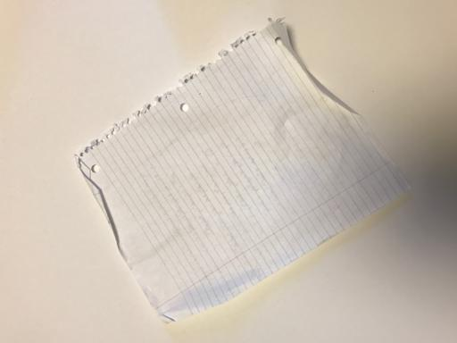

| Campo | Valor |
|---|---|
| Classe real | `paper` |
| Pergunta | "presisa lava antes?" |
| Visão | `paper` (conf. 0.976) — top-2: paper 0.98, trash 0.01 |
| PLN | `preparo_antes` (conf. 0.691) |
| Regra acionada | **R25** — SE classe=paper E intenção=preparo_antes E confiança>=0.60 ENTÃO resposta 'preparo_antes' para 'paper' |
| Visão acertou? | sim |

**Resposta:**

> Antes de descartar **papel**:
> - Não precisa lavar; apenas mantenha o papel limpo e seco.
> - Não amasse em bolinhas: prefira dobrar ou deixar plano.
> - Papel higiênico, guardanapo usado, papel carbono, fotos e papel plastificado NÃO são recicláveis (vão para o rejeito).

### Caso 07 — ERRO da visão com confiança alta (glass→plastic)

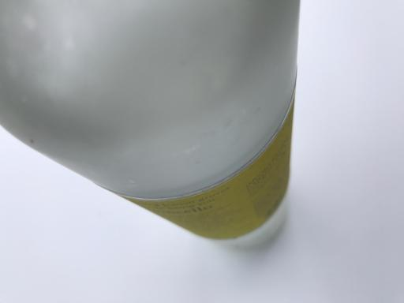

| Campo | Valor |
|---|---|
| Classe real | `glass` |
| Pergunta | "como descarto isso?" |
| Visão | `plastic` (conf. 0.826) — top-2: plastic 0.83, glass 0.10 |
| PLN | `como_descartar` (conf. 0.893) |
| Regra acionada | **R26** — SE classe=plastic E intenção=como_descartar E confiança>=0.60 ENTÃO resposta 'como_descartar' para 'plastic' |
| Visão acertou? | **NÃO** |

**Resposta:**

> Isso parece ser **plástico**. Descarte na lixeira VERMELHA (plástico) da coleta seletiva.

### Caso 08 — ERRO da visão com confiança alta (cardboard→paper)

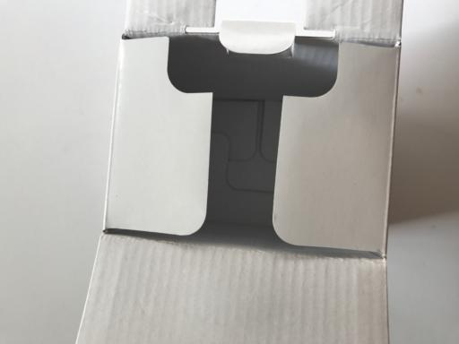

| Campo | Valor |
|---|---|
| Classe real | `cardboard` |
| Pergunta | "como descarto isso?" |
| Visão | `paper` (conf. 0.745) — top-2: paper 0.74, cardboard 0.12 |
| PLN | `como_descartar` (conf. 0.893) |
| Regra acionada | **R22** — SE classe=paper E intenção=como_descartar E confiança>=0.60 ENTÃO resposta 'como_descartar' para 'paper' |
| Visão acertou? | **NÃO** |

**Resposta:**

> Isso parece ser **papel**. Descarte na lixeira AZUL (papel) da coleta seletiva.

### Caso 09 — Baixa confiança, lixeiras diferentes (top-2)

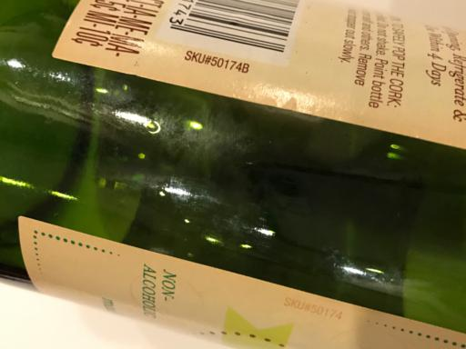

| Campo | Valor |
|---|---|
| Classe real | `glass` |
| Pergunta | "isso é reciclável?" |
| Visão | `glass` (conf. 0.598) — top-2: glass 0.60, cardboard 0.13 |
| PLN | `e_reciclavel` (conf. 0.973) |
| Regra acionada | **R04** — SE confiança_visão<0.60 E lixeiras diferentes ENTÃO mostrar top-2 e pedir nova foto |
| Visão acertou? | sim |

**Resposta:**

> Fiquei em dúvida entre duas opções (confiança abaixo de 60%):
> 
> **1) Vidro (60%)** — Sim! **Vidro** é reciclável. Coloque na lixeira **VERDE**. O vidro é 100% reciclável infinitas vezes, sem perda de qualidade.
> 
> **2) Papelão (13%)** — Sim! **Papelão** é reciclável. Coloque na lixeira **AZUL**. O papelão é um dos materiais mais valorizados pelas cooperativas.
> 
> Se puder, envie outra foto para eu confirmar.

### Caso 10 — Baixa confiança, mas top-2 com mesma lixeira

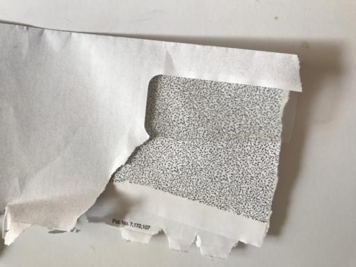

| Campo | Valor |
|---|---|
| Classe real | `paper` |
| Pergunta | "como descarto isso?" |
| Visão | `cardboard` (conf. 0.364) — top-2: cardboard 0.36, paper 0.34 |
| PLN | `como_descartar` (conf. 0.893) |
| Regra acionada | **R03** — SE confiança_visão<0.60 E lixeira(top1)=lixeira(top2) ENTÃO responder pelo grupo comum |
| Visão acertou? | **NÃO** |

**Resposta:**

> Não tenho certeza se é **papelão** (36%) ou **papel** (34%), mas os dois vão para a lixeira **AZUL**, então a orientação é a mesma.
> 
> Isso parece ser **papelão**. Descarte na lixeira AZUL (papel) da coleta seletiva, junto com outros papéis secos.

### Caso 11 — Confiança muito baixa — pede nova foto

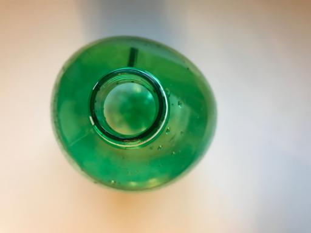

| Campo | Valor |
|---|---|
| Classe real | `plastic` |
| Pergunta | "como descarto isso?" |
| Visão | `plastic` (conf. 0.287) — top-2: plastic 0.29, metal 0.29 |
| PLN | `como_descartar` (conf. 0.893) |
| Regra acionada | **R02** — SE confiança_visão<0.35 ENTÃO pedir nova foto |
| Visão acertou? | sim |

**Resposta:**

> Não consegui identificar o material com segurança (confiança de 29%). Envie outra foto com o objeto sozinho, bem iluminado e sobre um fundo neutro.

### Caso 12 — Pergunta fora do escopo

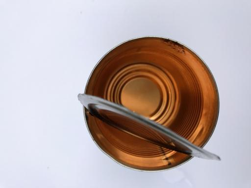

| Campo | Valor |
|---|---|
| Classe real | `metal` |
| Pergunta | "qual a previsão do tempo hoje?" |
| Visão | `metal` (conf. 0.875) — top-2: metal 0.87, cardboard 0.06 |
| PLN | `fora_do_escopo` (conf. 0.715) |
| Regra acionada | **R01** — SE intenção=fora_do_escopo E confiança_pln>=0.40 ENTÃO explicar o escopo |
| Visão acertou? | sim |

**Resposta:**

> Sou o EcoSort e só consigo ajudar com o descarte de resíduos. Pergunte, por exemplo: *como descarto isso?*, *isso é reciclável?*, *onde posso levar?* ou *precisa lavar antes?*

### Caso 13 — Gíria/informal

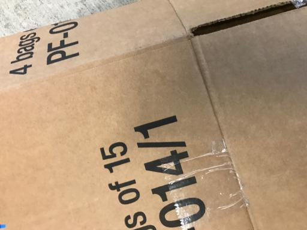

| Campo | Valor |
|---|---|
| Classe real | `cardboard` |
| Pergunta | "mano essa parada vai em qual lixo?" |
| Visão | `cardboard` (conf. 0.976) — top-2: cardboard 0.98, trash 0.01 |
| PLN | `como_descartar` (conf. 0.807) |
| Regra acionada | **R10** — SE classe=cardboard E intenção=como_descartar E confiança>=0.60 ENTÃO resposta 'como_descartar' para 'cardboard' |
| Visão acertou? | sim |

**Resposta:**

> Isso parece ser **papelão**. Descarte na lixeira AZUL (papel) da coleta seletiva, junto com outros papéis secos.

### Caso 14 — Pergunta ambígua (intenção incerta)

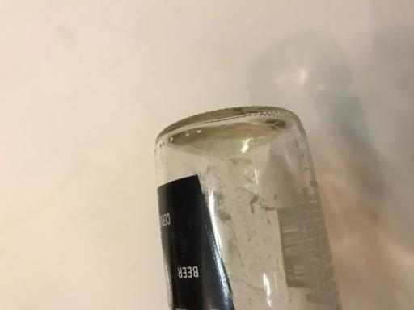

| Campo | Valor |
|---|---|
| Classe real | `glass` |
| Pergunta | "me explica esse item" |
| Visão | `glass` (conf. 0.865) — top-2: glass 0.86, trash 0.06 |
| PLN | `e_reciclavel` (conf. 0.329) |
| Regra acionada | **R05** — SE confiança_pln<0.40 ENTÃO resumo geral do material |
| Visão acertou? | sim |

**Resposta:**

> Não entendi bem a pergunta, então aqui vai um resumo sobre **vidro**:
> 
> - **Reciclável?** Sim
> - **Lixeira:** VERDE
> - **Preparo:** Enxágue para retirar restos de bebida/alimento (não precisa ficar perfeito).
> - **Destino:** Contêineres de vidro (PEVs) em supermercados e praças, ecopontos e cooperativas. Espelhos, lâmpadas e vidros temperados/de janela NÃO entram na reciclagem comum.
> 
> Se quiser algo específico, pergunte por exemplo *precisa lavar antes?*
